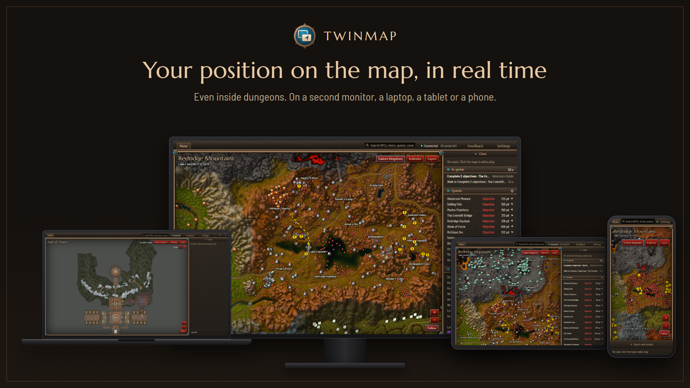
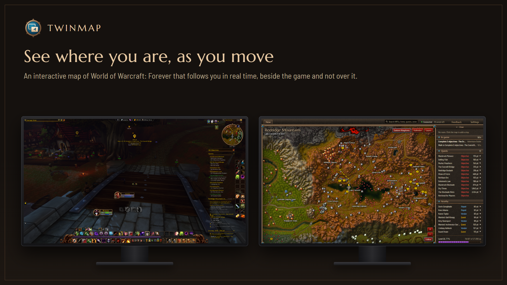
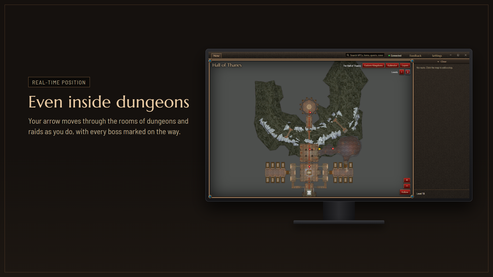
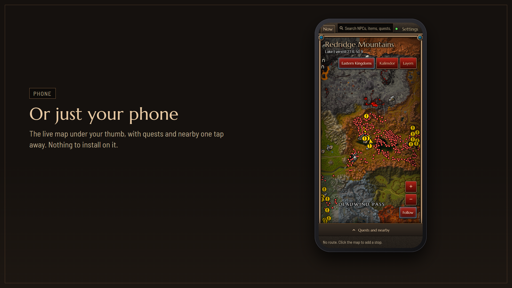

# Twinmap Forever

[](https://github.com/catubba/twinmap-forever/actions)
[](https://github.com/catubba/twinmap-forever/releases/latest)
[](https://github.com/catubba/twinmap-forever/releases)
[](LICENSE)
[](https://ko-fi.com/catubba)

**Your position on the map, in real time. Even inside dungeons.**

Twinmap is an interactive map of World of Warcraft: Forever for your second screen. It follows your character as you move and shows your quests, services and resources around you, on a second monitor, a laptop, a tablet or a phone.



## What it does

- **Real-time position.** Your arrow moves on the map as you move in the game, a few times a second.
- **Even inside dungeons.** In dungeons and raids the arrow moves through the rooms, with the bosses marked.
- **Your quests, as Questie shows them.** Available quests, turn-ins and objectives, the same ones Questie shows to your character.
- **Services and resources.** Flight masters, inns, vendors, repair, trainers, banks, ore and herbs, each one a layer you turn on or off.
- **Search.** NPCs, items, quests and zones, with the distance on foot.
- **From the map to the game.** Mark a point or build a route on Twinmap, and it appears in the game.
- **Phone and tablet.** No second monitor? Open the same map in the browser of a phone, a tablet or a laptop on your home network.

**Twinmap is free and open source.** No Overwolf, no ads, no account, no paid features. Nothing leaves your computer.





## Install

You need two things: the addon in the game, and the app on your computer.

1. **The addon.** Install [Twinmap Forever from CurseForge](https://www.curseforge.com/wow/addons/twinmap-forever), then restart the game.
2. **The app.** Download `Twinmap-Setup` from the [latest release](https://github.com/catubba/twinmap-forever/releases/latest) and open it. It installs for your Windows user only, asks for no administrator rights, and starts by itself.
3. **First run.** The app finds your game, builds the map from your own game files (once, about a minute), and waits for you to log in. Your arrow appears on its own.

After that the app updates itself: every time it starts it looks for a newer version and installs it before the map opens.

### Windows says "Windows protected your PC"

The installer is not signed yet, so Windows SmartScreen may stop it the first time. Click **More info**, then **Run anyway**. This happens only on the first download, not on updates.

You do not have to take our word for it: the code is all here, and every release can be built from it.

### What you need

- Windows 10 or 11
- World of Warcraft: Forever
- The game running and not minimized while you use the map

## How it works

Twinmap never touches the game's memory and never plays for you.

- **From the game to the app.** The addon draws a line one pixel tall at the edge of the game window and writes your position, zone and quests in the colors of its pixels. The app reads that line from the screen.
- **The map.** The app builds the map from the files of your own game, so it always matches your version of the game. No map is downloaded.
- **Inside dungeons.** The game does not tell addons where you are in a dungeon, so the app reads your place from the game's minimap on the screen. Keep the minimap visible and not rotating.
- **From the app to the game.** Points and routes go back through a few small files next to the addon, which the game reads by itself.

> **Photosensitivity warning.** The addon sends data by changing the colors of a one pixel line at the edge of the game window, many times per second. Its settings in the game can slow it down or pause it.

## Optional addons

None of these is needed. When one is installed, Twinmap shows more.

- [Questie](https://www.curseforge.com/wow/addons/questie): the map shows the same quests Questie shows in the game.
- [Shortest Path Forever](https://www.curseforge.com/wow/addons/shortest-path-forever): the map shows the journey it plans, and what you send to the game is reached along the roads.

## Phone and tablet

In the app, open **Settings**, turn on **Phone and tablet**, and scan the code with your phone. The map opens in its browser, with nothing to install. It works on your home network only, and only for devices that scanned the code.



## In active development

Twinmap is young and it is being worked on all the time. New versions come out often, and the app updates itself.

Here is what is planned, in no particular order. These are plans, not promises: what you ask for can change them.

- **Group**: your party on the map, quests you share, pins everyone sees
- **Travel**: time to arrive, flight paths, boats and zeppelins, your hearthstone
- **More on the map**: zones colored by level, the places you have explored, your corpse and the graveyard, rares and treasures
- **Quests**: your whole quest log, chains, rewards, and a plan for the session
- **Character**: experience per hour, professions, reputations, a reminder when your trainer has something new
- **Alerts**: full bags, broken gear, a disconnected game, and why you died
- **Items**: bags, bank and gear, readable with the game closed, and a shopping list
- **Tools**: a macro builder, your action bars, a talent calculator, a screenshot gallery
- **Guides**: leveling guides that turn into routes on the map
- **Global shortcuts** and a **signed installer**

Something missing? [Tell us](https://github.com/catubba/twinmap-forever/issues/new/choose).

## Privacy

- The app sends nothing to anyone. There is no account and no tracking.
- The only connection it makes is to GitHub, to look for a newer version of itself.
- The map on your home network is off until you turn it on.

## Not affiliated with Blizzard

Twinmap is a fan project. It is not affiliated with or endorsed by Blizzard Entertainment, and Blizzard has not authorized it. It only reads what the addon draws on your screen and the files of your own game, and it never automates anything, but you use it at your own risk.

World of Warcraft is a trademark of Blizzard Entertainment, Inc.

## Feedback

Found a bug, or have an idea? In the app, **Feedback** opens an issue here or an email, already filled with what we need to know.

- [Open an issue](https://github.com/catubba/twinmap-forever/issues/new/choose)
- No GitHub account? Write to dev@twinmap.app, in English or in Italian.

## Free and open source

Twinmap is free software, and it is open source: all of its code is in this repository, under the GNU General Public License, version 3. It is free to use, with no ads and no paid features, and it will stay that way.

**Anyone can contribute.** Report a bug, propose an idea, improve a text, or send a pull request with code. If you plan something large, open an issue first so we can talk about it before you spend your time.

## Support the project

Twinmap is made in spare time and costs nothing. If it is useful to you and you feel like it, you can [buy me a coffee on Ko-fi](https://ko-fi.com/catubba). It is never needed, and it unlocks nothing.

## Build it yourself

The repository holds both parts: `addon/` is the addon, `app/` is the desktop app (Electron, TypeScript, Svelte). You need Node.js 24.

```bash
cd app
npm ci
npm run dev    # run the app from the sources
npm test       # run the tests
npm run dist   # build the installer into app/dist
```

```bash
cd addon
npm ci
npm test       # run the addon in a simulated game
```

## License

Twinmap Forever is free software under the [GNU General Public License, version 3](LICENSE). It comes with no warranty.

It is built with the work of others, listed with their licenses in [THIRD-PARTY-LICENSES](THIRD-PARTY-LICENSES).
