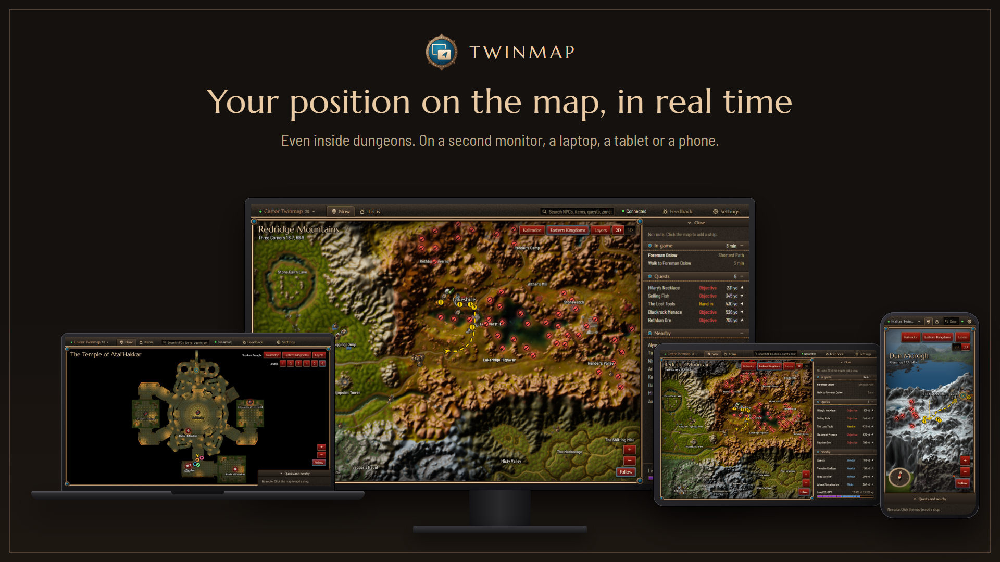
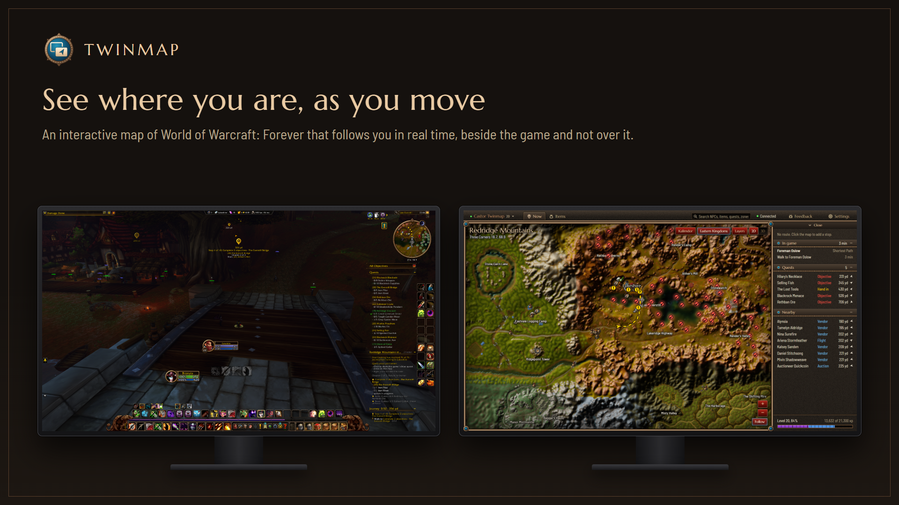
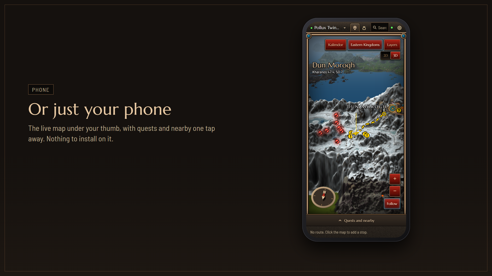

<h1 align="center">
  <picture>
    <source media="(prefers-color-scheme: dark)" srcset="docs/images/logo-dark.svg">
    
  </picture>
</h1>

<p align="center"><b>Your position on the map, in real time. In 2D or in 3D, even inside dungeons.</b><br>
An interactive map of World of Warcraft: Forever for your second screen.</p>

<p align="center">
  <a href="https://www.curseforge.com/wow/addons/twinmap-forever"></a>
  &nbsp;&nbsp;
  <a href="https://github.com/catubba/twinmap-forever/releases/latest/download/Twinmap-Setup.exe"></a>
</p>

<p align="center">You need both. Free, with no account, no ads and no Overwolf.</p>

<p align="center">
  <a href="https://github.com/catubba/twinmap-forever/releases/latest"></a>
  <a href="https://github.com/catubba/twinmap-forever/releases"></a>
  <a href="https://github.com/catubba/twinmap-forever/releases/latest"></a>
  <a href="LICENSE"></a>
  <a href="https://ko-fi.com/catubba"></a>
</p>



## Install in three steps

1. **The addon.** Install [Twinmap Forever from CurseForge](https://www.curseforge.com/wow/addons/twinmap-forever) and restart the game.
2. **The app.** [Download Twinmap for Windows](https://github.com/catubba/twinmap-forever/releases/latest/download/Twinmap-Setup.exe) and open the file. It asks for no administrator rights and starts by itself.
3. **Play.** The app finds your game and builds the map from your own game files, once, in a minute or two. Log in: your arrow appears on its own.

From then on the app updates itself, and the addon is updated from CurseForge.

<details>
<summary><b>Windows says "Windows protected your PC"</b></summary>

The installer is not signed yet, so Windows SmartScreen may stop it the first time. Click **More info**, then **Run anyway**. This happens only on the first download, not on updates.

You do not have to take our word for it: the code is all here, every release can be built from it, and every installer is scanned by [VirusTotal](https://www.virustotal.com) when it is published. The result is in the notes of each release and in the badge at the top of this page.
</details>

<details>
<summary><b>What you need, and installing by hand</b></summary>

- Windows 10 or 11
- World of Warcraft: Forever
- The game running and not minimized while you use the map

The CurseForge app installs [QuestieDB](https://www.curseforge.com/wow/addons/questiedb) with the addon: the data about NPCs, items and quests that the map reads. If you install the addon by hand, get QuestieDB too.

The addon is also attached to every release on GitHub, for addon managers that install from there, such as CurseBreaker and WowUp.

Every version of the app, with its notes, is on the [releases page](https://github.com/catubba/twinmap-forever/releases).
</details>

## macOS

On an Apple Silicon Mac with Node.js 24 and Xcode, run `cd app && npm ci && npm run dist:mac`. Open the ad-hoc signed `app/dist/mac-arm64/Twinmap.app`. Allow Twinmap under **System Settings > Privacy & Security > Screen Recording**, then reopen Twinmap.

Twinmap checks `/Applications/World of Warcraft` and `~/Applications/World of Warcraft` for Forever. It reads the game and addon files. Pins and routes stay in Twinmap on macOS. To verify capture with a synthetic window, run `npm run probe:mac` from `app/` with Screen Recording access for the Electron app used by the probe.

## What it does

### 2D or 3D, one switch

One click turns the flat map into the land itself: mountains, valleys, coasts and rivers in relief, to turn, tilt and zoom, with your arrow, your quests and your route standing on the ground. In 2D and in 3D the map can turn with your character, as Rotate Minimap does in the game, or keep north up. Come close to a cave, a mine or Ironforge and the ground opens over it.


### Even inside dungeons

In dungeons and raids the arrow moves through the rooms, with the bosses marked and your companions beside you, each in the colour of their class. Open a dungeon's map from its door, before you go in.


### Search an item, find who sells it

Search NPCs, items, quests, zones, dungeons and your own pins, with the distance on foot. An item is listed once for each vendor who sells it, the nearest first, and choosing one opens what that vendor sells and at what price.


### Every character, with the game closed

Bags, bank, gear and statistics of every character you play, with a picture of each. A filter leaves lit what you are looking for, and tells you which other character holds it.


### And more

- **In your language.** English, Français, Deutsch, Español (España), Español (Latinoamérica), Русский, 한국어 and 简体中文, the app and the addon, with the names of your game in its own language.
- **Auction House.** The prices of your character's auction house, every hour: what your bags, bank and gear are worth, how a price moved over a day or a week, and an alert when it crosses your line.
- **Your quests.** Where to hand in what is done and where to find what is left, for every quest of your log. With Questie installed, the ones to take as well.
- **Services and resources.** Flight masters, inns, vendors, repair, trainers, banks, ore and herbs, each one a layer you turn on or off.
- **Caves and mines.** Zoom in on a zone and their galleries show through the ground, before you go in.
- **When you die.** The map marks your corpse, the graveyard and the way back on foot, or the door of the dungeon you died in.
- **From the map to the game.** Mark a point or build a route on Twinmap, and it appears in the game.



## On a phone, a tablet or a laptop

No second monitor? In the app, open **Settings**, turn on **Phone and tablet**, and scan the code with your phone. The map opens in its browser, in 2D or in 3D, with nothing to install. It works on your home network only, and only for devices that scanned the code.

<p align="center"></p>

## Good to know

<details>
<summary><b>How it works</b></summary>

Twinmap never touches the game's memory and never plays for you.

- **From the game to the app.** The addon draws a line one pixel tall at the edge of the game window and writes your position, your zone, your quests and what your character carries, wears and knows in the colors of its pixels. The app reads that line from the screen.
- **The map.** The app builds the map from the files of your own game, so it always matches your version of the game. No map is downloaded.
- **Inside dungeons.** The game does not tell addons where you are in a dungeon, so the app reads your place from the game's minimap on the screen. Keep the minimap visible, not rotating and zoomed all the way out.
- **The picture of your character.** When you open the character window, the app reads the picture of your character from the screen, as it does the minimap.
- **From the app to the game.** Points and routes go back through a few small files next to the addon, which the game reads by itself.
- **Your group.** The game tells the addon where your companions are. From far away it tells it only every few seconds, so in a group each Twinmap addon also tells the others where its own character is, through the game. Inside a dungeon the game tells nothing at all: there each Twinmap tells the group the place it reads from its own minimap.
</details>

<details>
<summary><b>Optional addons: Questie and Shortest Path Forever</b></summary>

None of these is needed. When one is installed, Twinmap shows more.

- [Questie](https://www.curseforge.com/wow/addons/questie): the map shows the same quests Questie shows in the game, with the ones you can take. Without it, the map shows the quests of your log.
- [Shortest Path Forever](https://www.curseforge.com/wow/addons/shortest-path-forever): the map shows the whole journey it plans, flights, boats and the tram included, on the floor the game guides you on, and what you send to the game is reached along the roads.


</details>

<details>
<summary><b>Privacy</b></summary>

- The app sends nothing by itself unless you turn on Help improve Twinmap, in Settings: it is off until you do. There is no account and no tracking.
- It connects to the internet to look for a newer version of itself, on GitHub; to fetch the prices of your auction house from prices.twinmap.app, about once an hour, asking for that house and nothing about you; when you press Send in the Feedback window; and, if you turn on Help improve Twinmap, to send anonymous data about the world of Forever. What is sent and where it goes: [twinmap.app/privacy.html](https://twinmap.app/privacy.html).
- The map on your home network is off until you turn it on.
- What the app keeps of your characters, their picture included, stays on your computer.
</details>

<details>
<summary><b>What is planned</b></summary>

Twinmap is young and it is being worked on all the time. New versions come out often, and the app updates itself.

Here is what is planned, in no particular order. These are plans, not promises: what you ask for can change them.

- **Group**: quests you share, pins everyone sees
- **Travel**: time to arrive, flight paths, boats and zeppelins, your hearthstone
- **More on the map**: zones colored by level, the places you have explored, rares and treasures
- **Quests**: your whole quest log, chains, rewards, and a plan for the session
- **Character**: experience per hour, professions, reputations, a reminder when your trainer has something new
- **Alerts**: full bags, broken gear, a disconnected game, and why you died
- **Items**: a shopping list
- **Tools**: a macro builder, your action bars, a talent calculator, a screenshot gallery
- **Guides**: leveling guides that turn into routes on the map
- **Global shortcuts** and a **signed installer**
</details>

> **Photosensitivity warning.** The addon sends data by changing the colors of a one pixel line at the edge of the game window, many times per second. Its settings in the game can slow it down or pause it, and the pause button at the top of the app pauses it too.

## Feedback

Found a bug, or have an idea? In the app, **Feedback** sends us your message. You can also [open an issue](https://github.com/catubba/twinmap-forever/issues/new/choose) or write to dev@twinmap.app, in English or in Italian.

## Free and open source

All of Twinmap's code is in this repository, under the GNU General Public License, version 3. It is free to use, with no ads and no paid features, and it will stay that way.

**Anyone can contribute.** Report a bug, propose an idea, improve a text, or send a pull request with code. If you plan something large, open an issue first so we can talk about it before you spend your time.

Twinmap is made in spare time and costs nothing. If it is useful to you and you feel like it, you can [buy me a coffee on Ko-fi](https://ko-fi.com/catubba). It is never needed, and it unlocks nothing.

<details>
<summary><b>Build it yourself</b></summary>

The repository holds both parts: `addon/` is the addon, `app/` is the desktop app (Electron, TypeScript, Svelte). You need Node.js 24.

```bash
cd app
npm ci
npm run dev    # run the app from the sources
npm test       # run the tests
npm run dist   # build the installer into app/dist
```

```bash
cd addon
npm ci
npm test       # run the addon in a simulated game
```
</details>

## License

Twinmap Forever is free software under the [GNU General Public License, version 3](LICENSE). It comes with no warranty. It is built with the work of others, listed with their licenses in [THIRD-PARTY-LICENSES](THIRD-PARTY-LICENSES).

Twinmap is a fan project. It is not affiliated with or endorsed by Blizzard Entertainment, and Blizzard has not authorized it. It only reads what the addon draws on your screen and the files of your own game, and it never automates anything, but you use it at your own risk. World of Warcraft is a trademark of Blizzard Entertainment, Inc.
